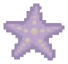
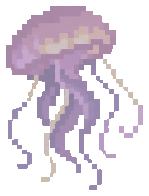
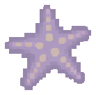
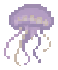
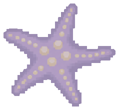

  

  <h1>¡Hola, soy Valeria!</h1>

  
Actualmente estoy estudiando Ingeniería de Software en la UPC. Por el momento, cuento con experiencia en proyectos de desarrollo full-stack, utilizando tecnologías como Java, Python, Spring Boot, Angular y React, además de herramientas y servicios cloud.

  
Me entusiasma seguir aprendiendo, explorar nuevas tecnologías y contribuir al desarrollo de soluciones que sean útiles para los demás.

  

    
    
    
    
  

## Tecnologías

### Lenguajes de programación

### Backend

### Frontend

### Bases de datos

### Cloud y herramientas

 

## Un poco más sobre mí

Fuera de la programación, disfruto pasar tiempo con mis amigos, conocer nuevas personas y descubrir actividades diferentes. Me gustan los animales, la música y la repostería, y amo las nuevas experiencias

Algunas cositas sobre mí:

- Me gusta experimentar con nuevas herramientas y descubrir distintas formas de hacer las cosas.
- Me encantan los animales, actualmente tengo 2 perritos, Dolly y Teddy
- Disfruto preparar pasteles y cocinar para mi familia y amigos
- Mis hobbies favoritos son el snowboard y el patinaje sobre hielo.
- Mi época favorita del año es la Navidad, amo la nieve y el compartir
- Disfruto conocer nuevas personas, trabajar en equipo y aprender de los demás.

  
  

## Contacto

Te invito a conocer más sobre mis proyectos, puedes visitar mi [portfolio](https://varojasg.github.io/) o pasar por mi [LinkedIn](https://www.linkedin.com/in/valeria-rojas-gomez/). No dudes en contactarme a mi correo [**varojasgomez@gmail.com**](mailto:varojasgomez@gmail.com).

  
  
  

